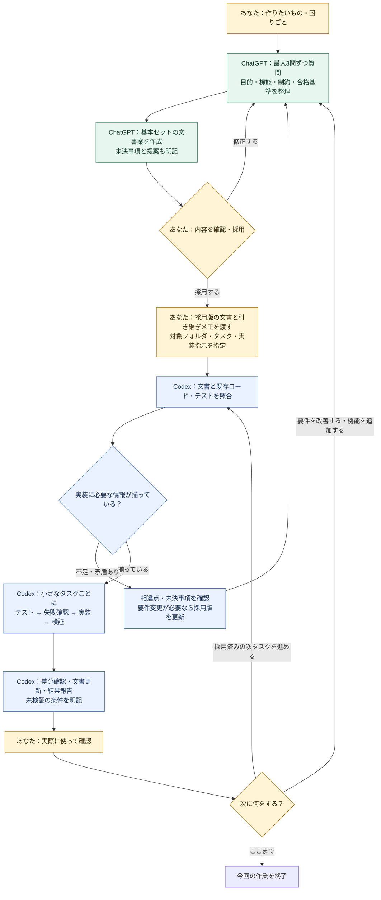
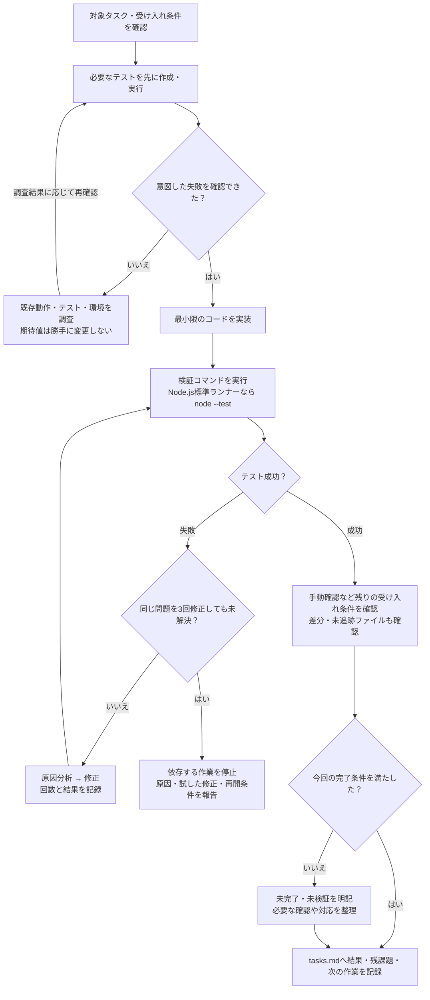

# ChatGPTとCodexで進める開発の流れ

ChatGPTで「何を作り、何を合格とするか」を整理し、採用した文書をCodexへ渡して実装します。
開始時に使うプロンプトは [START_PROMPT.md](START_PROMPT.md) にあります。

## 全体のイメージ

黄色はあなたの判断・操作、緑はChatGPTでの整理、青はCodexでの確認・実装です。
会話履歴の自動共有を前提にせず、文書を引き継ぎの基準にします。

## Codexで回すテスト駆動のループ

修正回数は最初の失敗後に数え、同じ問題への修正・再実行は最大3回です。
準備段階での環境不備も放置せず、同じ問題を3回修正しても解消しなければ停止・報告します。
文書だけの変更では、テストを形式的に作らず、内容・リンク・差分などを確認します。

## 基本セットの役割

| 文書・ディレクトリ | ChatGPTで準備するもの | Codexで確認・実施すること |
| --- | --- | --- |
| requirements.md | 目的、対象範囲、要件ID、受け入れ条件 | 要件を基準に実装・検証。実装中は勝手に変更しない |
| design.md | アーキテクチャ、データ構造、設計案と理由 | 既存コードと照合し、実装に応じて設計を更新 |
| tasks.md | 要件に対応する小さなタスクと未決事項 | 進捗、実際の検証結果、残課題、次の作業を記録 |
| AGENTS.md | 共通ルールを維持し、プロジェクト固有の案を整理 | 作業ルールに従い、実際の検証コマンドを確認・設定 |
| tests/ | tests/README.mdにテスト計画を整理 | 自動テストを実装・実行し、要件との対応を管理 |

## 引き継ぐもの

- 採用する文書の版と、対象アプリ・作業ディレクトリ。
- 採用済みの決定事項、未採用の提案、未決事項とその影響。
- 最初に実装するタスクID・範囲と、実装開始の指示。
- 既存アプリなら最新のコードと文書。ChatGPTへは必要な資料を添付し、Codexには作業リポジトリを指定。

実装を終えたら、更新した設計と進捗を次のChatGPTでの整理へ戻します。
コミット・push・デプロイは、必要なときに別途指示します。
